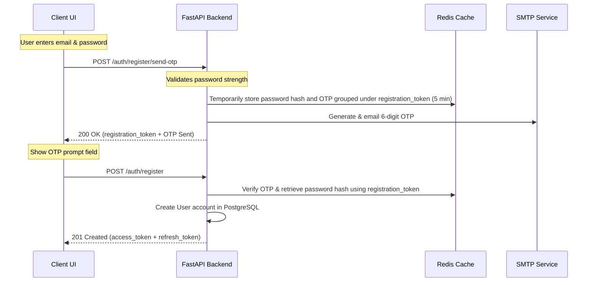
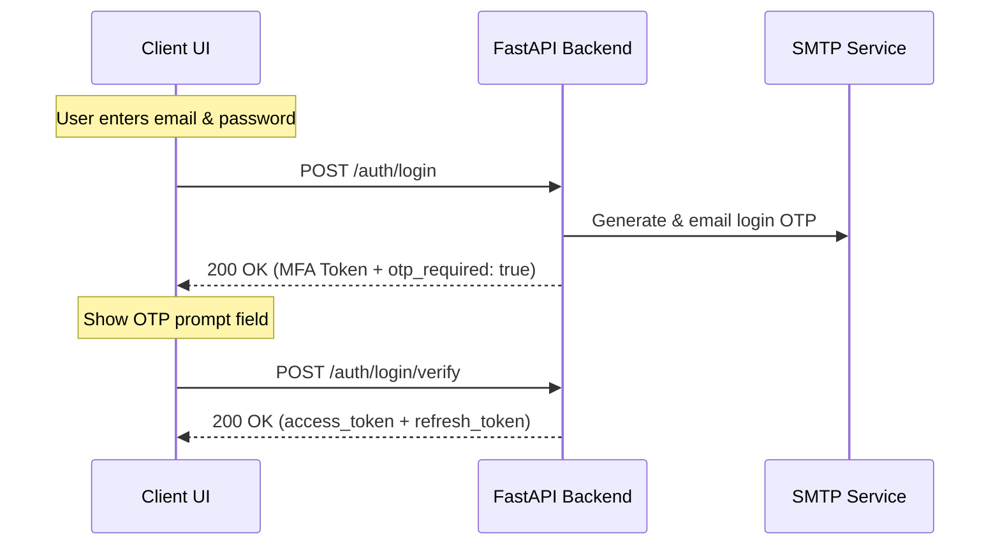

# 🧠 Open-Brain Backend — Complete API & Integration Specifications

This document provides a comprehensive specification of all REST endpoints exposed by the Open-Brain FastAPI server, accompanied by client-side architecture designs, state transitions, and integration patterns for frontend developers (Android/Kotlin, Web, and Desktop).

---

## 🧭 1. Architectural Overview & Security

- **Base URL**: `http://localhost:8000` (Local) / Nginx proxy / Cloudflare Tunnel
- **Security Scheme**: JWT Bearer Authentication (OAuth2)
- **Required Header**: `Authorization: Bearer <access_token>`
- **Content Type**: `application/json` (except SSE streams which yield `text/event-stream`)

```
┌──────────────────┐               Request (JSON Payload)             ┌──────────────────┐
│                  ├─────────────────────────────────────────────────>│                  │
│  Android / Web   │                                                  │ Open-Brain       │
│  Client App      │<─────────────────────────────────────────────────┤ FastAPI Backend  │
│                  │        Response (JSON or Server-Sent Events)     │                  │
└──────────────────┘                                                  └──────────────────┘
```

---

## 🔐 2. Authentication Flow Specifications

Open-Brain implements a secure 2-step verification for both registration and login.

### Flow A: User Registration



#### 1. Initiate Registration (Step 1)
- **Endpoint**: `POST /auth/register/send-otp`
- **Authentication**: None
- **Payload (`RegisterInitiateRequest`)**:
  ```json
  {
    "email": "user@example.com",
    "password": "SecurePassword123"
  }
  ```
  *(Note: Password must be at least 8 characters, containing at least one uppercase letter, one lowercase letter, and one digit).*
- **Backend Action**: Validates email duplication and password complexity. Generates a unique `registration_token` (UUID) and a 6-digit OTP. Hashes the password and stores the session data in Redis (`register:pending:{registration_token}`) with a 5-minute expiration. Sends the OTP to the user's email.
- **Responses**:
  - `200 OK`:
    ```json
    {
      "registration_token": "550e8400-e29b-41d4-a716-446655440000",
      "message": "OTP sent to your email address."
    }
    ```
  - `409 Conflict`: `{"detail": "An account with this email already exists."}`
  - `422 Unprocessable Entity`: Password validation details.

#### 2. Verify Registration (Step 2)
- **Endpoint**: `POST /auth/register`
- **Authentication**: None
- **Payload (`RegisterVerifyRequest`)**:
  ```json
  {
    "registration_token": "550e8400-e29b-41d4-a716-446655440000",
    "email": "user@example.com",
    "otp": "123456"
  }
  ```
- **Backend Action**: Retrieves the session data from Redis using `registration_token`. Verifies that the provided email and OTP match the stored session. If valid, creates the User record in PostgreSQL, deletes the Redis key, and generates a session.
- **Responses**:
  - `201 Created`: Logs the user in immediately. Returns access and refresh token pair:
    ```json
    {
      "access_token": "eyJhbGciOi...",
      "refresh_token": "eyJhbGciOi...",
      "token_type": "bearer"
    }
    ```
  - `400 Bad Request`: `{"detail": "Invalid or expired OTP. Please request a new one."}` or `{"detail": "Registration session expired or invalid. Please request a new OTP."}`

---

### Flow B: MFA User Login



#### 1. Validate Password (Step 1)
- **Endpoint**: `POST /auth/login`
- **Authentication**: None
- **Payload (`LoginRequest`)**:
  ```json
  {
    "email": "user@example.com",
    "password": "SecurePassword123"
  }
  ```
- **Backend Action**: Validates credentials. If correct, generates a short-lived (5 min) `mfa_token` (JWT type `mfa_challenge`) and sends a login OTP to the user's email.
- **Responses**:
  - `200 OK`:
    ```json
    {
      "otp_required": true,
      "mfa_token": "eyJhbGciOi...",
      "email": "user@example.com"
    }
    ```
  - `401 Unauthorized`: `{"detail": "Invalid email or password."}`
  - `429 Too Many Requests`: `{"detail": "Too many login attempts. Please try again in 15 minutes."}` (Rate limited to 5 attempts per 15 minutes).

#### 2. Verify Login OTP (Step 2)
- **Endpoint**: `POST /auth/login/verify`
- **Authentication**: None
- **Payload (`VerifyLoginOTPRequest`)**:
  ```json
  {
    "mfa_token": "eyJhbGciOi...",
    "otp": "654321"
  }
  ```
- **Backend Action**: Verifies the `mfa_token` signature and expiration, checks the email OTP in Redis, resets the rate limit, and issues session tokens.
- **Responses**:
  - `200 OK`:
    ```json
    {
      "access_token": "eyJhbGciOi...",
      "refresh_token": "eyJhbGciOi...",
      "token_type": "bearer"
    }
    ```
  - `400 Bad Request`: `{"detail": "Invalid or expired OTP. Please request a new one."}`
  - `401 Unauthorized`: `{"detail": "MFA token is invalid or expired. Please log in again."}`

---

### Flow C: Session Refresh (Token Rotation)

- **Endpoint**: `POST /auth/refresh`
- **Authentication**: Bearer Token (Pass the **Refresh Token** in the `Authorization` header instead of the access token).
- **Backend Action**: Decodes the refresh token, verifies the signature/expiration, confirms it hasn't been revoked, revokes the old refresh token, and issues a brand-new token pair.
- **Responses**:
  - `200 OK`:
    ```json
    {
      "access_token": "eyJhbGciOi...",
      "refresh_token": "eyJhbGciOi...",
      "token_type": "bearer"
    }
    ```
  - `401 Unauthorized`: `{"detail": "Session has been revoked. Please log in again."}`

---

### Flow D: Session Logout

- **Endpoint**: `POST /auth/logout`
- **Authentication**: Bearer `access_token`
- **Backend Action**: Revokes all active refresh tokens associated with the current user, blacklisting them to instantly terminate the session.
- **Responses**:
  - `200 OK`: `{"message": "Successfully logged out."}`
  - `401 Unauthorized`: Token invalid or missing.

---

## 👤 3. User Profiles Endpoint

- **Endpoint**: `GET /users/me`
- **Authentication**: Bearer `access_token`
- **Responses**:
  - `200 OK`:
    ```json
    {
      "id": "e4b6795e-14fa-4b68-80f0-8c29bf3e94be",
      "email": "user@example.com",
      "is_verified": true,
      "plan": "free",
      "created_at": "2026-07-04T12:00:00Z"
    }
    ```

---

## 🗄️ 4. Chat History Endpoints

Endpoints used by the frontend to browse, read, and delete past conversations.

### 1. List Conversations (Paginated)
- **Endpoint**: `GET /chats`
- **Authentication**: Bearer `access_token`
- **Query Parameters**:
  - `page` (integer, default: `1`, minimum: `1`)
  - `page_size` (integer, default: `20`, range: `1-100`)
- **Responses**:
  - `200 OK`:
    ```json
    {
      "conversations": [
        {
          "chat_id": "4a613be3-0b19-48bb-bb85-dfa52f9547d2",
          "title": "Explain machine learning in one sentence...",
          "updated_at": "2026-07-04T12:32:00Z"
        }
      ],
      "total": 1,
      "page": 1,
      "page_size": 20,
      "has_next": false
    }
    ```

### 2. Get Message Log
- **Endpoint**: `GET /chats/{chat_id}/history`
- **Authentication**: Bearer `access_token`
- **Path Parameter**: `chat_id` (string, UUID)
- **Responses**:
  - `200 OK`:
    ```json
    {
      "chat_id": "4a613be3-0b19-48bb-bb85-dfa52f9547d2",
      "title": "Explain machine learning in one sentence...",
      "messages": [
        {
          "id": "msg_001",
          "role": "user",
          "content": "Explain machine learning in one sentence.",
          "provider_used": null,
          "token_count": 8,
          "is_partial": false,
          "created_at": "2026-07-04T12:30:00Z"
        },
        {
          "id": "msg_002",
          "role": "assistant",
          "content": "Machine learning is a field of computer science...",
          "provider_used": "ollama",
          "token_count": 22,
          "is_partial": false,
          "created_at": "2026-07-04T12:30:05Z"
        }
      ],
      "created_at": "2026-07-04T12:30:00Z",
      "updated_at": "2026-07-04T12:30:05Z"
    }
    ```
  - `404 Not Found`: `{"detail": "Conversation not found."}`

### 3. Delete Conversation
- **Endpoint**: `DELETE /chats/{chat_id}`
- **Authentication**: Bearer `access_token`
- **Path Parameter**: `chat_id` (string, UUID)
- **Responses**:
  - `200 OK`: `{"message": "Conversation deleted successfully."}`
  - `404 Not Found`: `{"detail": "Conversation not found."}`

---

## 🤖 5. AI Gateway Endpoints (SSE Streaming)

The core feature area mapping to model completions, characters selection, and chunked SSE streaming.

### 1. List AI Characters (Personas)
- **Endpoint**: `GET /ai/characters`
- **Authentication**: Bearer `access_token`
- **Responses**:
  - `200 OK`:
    ```json
    [
      {
        "id": "coder",
        "name": "Code Wizard",
        "description": "An expert programmer who writes clean, efficient code.",
        "system_prompt": "You are Code Wizard, an expert software engineer...",
        "avatar": null
      }
    ]
    ```

### 2. Send Chat Prompt (Streaming Response)
- **Endpoint**: `POST /ai/chat`
- **Authentication**: Bearer `access_token`
- **Payload (`ChatRequest`)**:
  ```json
  {
    "prompt": "Hello assistant, write a story about a spaceship.",
    "provider": "ollama",
    "chat_id": "4a613be3-0b19-48bb-bb85-dfa52f9547d2", 
    "model": "gemma3:4b",
    "character_id": "coder"
  }
  ```
  - `prompt`: String (1 to 50000 characters). Required.
  - `provider`: String. Must be `"claude"`, `"openai"`, or `"ollama"`. Required.
  - `chat_id`: String (UUID). Optional. If supplied, the message appends to that conversation. If omitted, a brand-new conversation is created automatically.
  - `model`: String. Optional. Override provider configuration.
  - `character_id`: String. Optional. Inject character's system prompt.

#### 📡 Response Event stream (`text/event-stream`)
The server streams chunks using Server-Sent Events (SSE). The frontend must listen for the following three custom events:

1. **`chat_start`**: Fired immediately upon connection.
   - **Data**: `{"chat_id": "UUID-string", "title": "Truncated prompt..."}`
   - **UI Action**: If starting a new chat, the frontend must save the `chat_id` in its active state (e.g., transition the router route from `/chats/new` to `/chats/{chat_id}`).
2. **`chunk`**: Fired continuously as tokens are generated.
   - **Data**: `{"text": "token text here"}`
   - **UI Action**: Append `"text"` to the typing bubble inside the UI list.
3. **`done`**: Fired when the generation is complete.
   - **Data**: `{"status": "complete"}`
   - **UI Action**: Stop the loading / typing state in the UI.

---


---

## 📁 6. Folders & Projects Endpoints

Endpoints to organize user conversations into projects/folders.

### 1. List Folders
- **Endpoint**: `GET /folders`
- **Authentication**: Bearer `access_token`
- **Responses**:
  - `200 OK`:
    ```json
    [
      {
        "id": "f8d87ea6-d5ab-44de-9da3-de1962265d31",
        "name": "Work Projects",
        "created_at": "2026-07-07T12:00:00Z"
      }
    ]
    ```

### 2. Create Folder
- **Endpoint**: `POST /folders`
- **Authentication**: Bearer `access_token`
- **Payload**:
    ```json
    {
      "name": "Personal Studies"
    }
    ```
- **Responses**:
  - `201 Created`: Returns the newly created folder details.

### 3. Rename Folder
- **Endpoint**: `PATCH /folders/{folder_id}`
- **Authentication**: Bearer `access_token`
- **Payload**:
    ```json
    {
      "name": "Deep Learning Studies"
    }
    ```
- **Responses**:
  - `200 OK`: Returns the updated folder details.

### 4. Delete Folder
- **Endpoint**: `DELETE /folders/{folder_id}`
- **Authentication**: Bearer `access_token`
- **Responses**:
  - `200 OK`: `{"message": "Folder deleted successfully. Conversations inside have been un-filed."}`

---

## 📎 7. File Attachments Endpoints

### 1. Upload Attachment
- **Endpoint**: `POST /chats/{chat_id}/attachments`
- **Authentication**: Bearer `access_token`
- **Payload**: Multipart file upload (`file` parameter).
- **Responses**:
  - `201 Created`:
    ```json
    {
      "id": "att_9a8b7c6d5e",
      "filename": "chart.png",
      "content_type": "image/png",
      "size_bytes": 204850,
      "url": "http://localhost:8000/attachments/att_9a8b7c6d5e"
    }
    ```

### 2. Download Attachment
- **Endpoint**: `GET /attachments/{attachment_id}`
- **Authentication**: Bearer `access_token`
- **Responses**:
  - `200 OK`: Serves binary payload with appropriate `Content-Type`.

### 3. Delete Attachment
- **Endpoint**: `DELETE /attachments/{attachment_id}`
- **Authentication**: Bearer `access_token`
- **Responses**:
  - `200 OK`: `{"message": "Attachment deleted."}`

---

## 💳 8. Billing & Subscription Endpoints

### 1. List Plans
- **Endpoint**: `GET /billing/plans`
- **Authentication**: None
- **Responses**:
  - `200 OK`:
    ```json
    [
      {
        "id": "premium",
        "name": "Premium Plan",
        "price": 1000,
        "currency": "USD"
      }
    ]
    ```

### 2. Subscribe to Plan
- **Endpoint**: `POST /billing/subscribe`
- **Authentication**: Bearer `access_token`
- **Payload**: `{"plan_id": "premium"}`
- **Responses**:
  - `200 OK`: `{"checkout_url": "https://stripe.com/checkout/..."}`

### 3. Cancel Subscription
- **Endpoint**: `POST /billing/cancel`
- **Authentication**: Bearer `access_token`
- **Responses**:
  - `200 OK`: `{"message": "Subscription cancelled."}`

### 4. Get Invoices
- **Endpoint**: `GET /billing/invoices`
- **Authentication**: Bearer `access_token`
- **Responses**:
  - `200 OK`:
    ```json
    [
      {
        "id": "inv_12345",
        "amount": 1000,
        "date": "2026-07-07T12:00:00Z",
        "pdf_url": "http://localhost:8000/billing/invoices/inv_12345.pdf"
      }
    ]
    ```

---

## 🔔 9. Notifications & Support Endpoints

### 1. List Notifications
- **Endpoint**: `GET /notifications`
- **Authentication**: Bearer `access_token`
- **Responses**:
  - `200 OK`:
    ```json
    [
      {
        "id": "notif_001",
        "title": "Welcome to Open-Brain!",
        "message": "Start typing prompts to get assistant answers.",
        "read": false
      }
    ]
    ```

### 2. Mark Notification as Read
- **Endpoint**: `PATCH /notifications/{id}/read`
- **Authentication**: Bearer `access_token`
- **Responses**:
  - `200 OK`: `{"id": "notif_001", "read": true}`

### 3. Submit Support Contact Request
- **Endpoint**: `POST /support/contact`
- **Authentication**: None
- **Payload**:
    ```json
    {
      "name": "Jane Doe",
      "email": "jane@example.com",
      "message": "I need help with my payment."
    }
    ```
- **Responses**:
  - `200 OK`: `{"message": "Support ticket created successfully."}`

---

## 🧾 10. Admin Endpoints

### 1. List Users
- **Endpoint**: `GET /admin/users`
- **Authentication**: Bearer `access_token` (Admin role check required)
- **Responses**:
  - `200 OK`: Paginated users list.

### 2. Update User Plan
- **Endpoint**: `PATCH /admin/users/{id}/plan`
- **Authentication**: Bearer `access_token` (Admin role)
- **Payload**: `{"plan": "premium"}`
- **Responses**:
  - `200 OK`: Updated UserProfileResponse.

### 3. Get Admin Statistics
- **Endpoint**: `GET /admin/stats`
- **Authentication**: Bearer `access_token` (Admin role)
- **Responses**:
  - `200 OK`:
    ```json
    {
      "total_users": 1500,
      "premium_users": 320,
      "total_messages": 82000,
      "total_revenue": 320000
    }
    ```

---

## 🛠️ 11. Client Design & Integration Patterns

### A. Local Storage & Silent Session Rotation
Clients must store the `access_token` and `refresh_token` locally (e.g., SharedPreferences on Android, LocalStorage in web apps). 

Because access tokens expire quickly (default: 30 minutes), the frontend should implement an interceptor that catches any `401 Unauthorized` error, triggers a silent token rotation via `POST /auth/refresh`, updates local storage, and retries the original request.

#### Android (Kotlin) OkHttp Authenticator Pattern
```kotlin
class TokenAuthenticator(
    private val tokenStorage: TokenStorage,
    private val authApiService: Lazy<AuthApiService>
) : Authenticator {
    override fun authenticate(route: Route?, response: okhttp3.Response): Request? {
        val refreshToken = tokenStorage.getRefreshToken() ?: return null

        synchronized(this) {
            val currentAccess = tokenStorage.getAccessToken()
            val reqAccess = response.request.header("Authorization")?.replace("Bearer ", "")
            
            // If token was already updated by another concurrent request, retry with new token
            if (currentAccess != reqAccess) {
                return response.request.newBuilder()
                    .header("Authorization", "Bearer $currentAccess")
                    .build()
            }

            // Sync POST /auth/refresh call
            val res = authApiService.get().refreshTokens("Bearer $refreshToken").execute()
            if (res.isSuccessful && res.body() != null) {
                val tokens = res.body()!!
                tokenStorage.saveTokens(tokens.access_token, tokens.refresh_token)
                return response.request.newBuilder()
                    .header("Authorization", "Bearer ${tokens.access_token}")
                    .build()
            } else {
                // Refresh failed or session revoked
                tokenStorage.clearTokens()
                triggerLogoutBroadcast()
                return null
            }
        }
    }
}
```

---

### B. Consuming POST-based Server-Sent Events (SSE)
Since standard browser `EventSource` and basic SSE libraries only support `GET` requests without headers, the frontend must manually stream the response body of a `POST` request.

#### Android (Kotlin) OkHttp SSE & CallbackFlow Pattern
```kotlin
fun streamChat(chatRequest: ChatRequest): Flow<ChatStreamEvent> = callbackFlow {
    val requestBody = Gson().toJson(chatRequest).toRequestBody("application/json".toMediaType())
    val request = Request.Builder()
        .url("http://localhost:8000/ai/chat")
        .post(requestBody)
        .header("Authorization", "Bearer ${tokenStorage.getAccessToken()}")
        .header("Accept", "text/event-stream")
        .build()

    val listener = object : EventSourceListener() {
        override fun onEvent(eventSource: EventSource, id: String?, event: String?, data: String) {
            when (event) {
                "chat_start" -> {
                    val start = Gson().fromJson(data, ChatStartData::class.java)
                    trySend(ChatStreamEvent.ChatStart(start.chat_id, start.title))
                }
                "chunk" -> {
                    val chunk = Gson().fromJson(data, ChunkData::class.java)
                    trySend(ChatStreamEvent.Chunk(chunk.text))
                }
                "done" -> {
                    trySend(ChatStreamEvent.Done)
                    close()
                }
            }
        }
        override fun onFailure(eventSource: EventSource, t: Throwable?, response: Response?) {
            trySend(ChatStreamEvent.Error(t?.message ?: "Unknown Connection Error"))
            close(t)
        }
    }

    val sseFactory = EventSources.createFactory(okHttpClient)
    val eventSource = sseFactory.newEventSource(request, listener)

    awaitClose { eventSource.cancel() } // Close connection on coroutine cancellation
}
```

---

### C. Complete Retrofit Interface & DTOs for All Endpoints

Here is the complete implementation code for calling the rest of the endpoints (Auth, Chats, and Users) from Android using Retrofit.

#### 1. Data Transfer Objects (DTOs)
```kotlin
package com.openbrain.data.remote

// --- Auth DTOs ---
data class RegisterInitiateRequest(val email: String, val password: String)
data class RegisterVerifyRequest(val email: String, val otp: String)
data class LoginRequest(val email: String, val password: String)
data class LoginMFAChallengeResponse(val otp_required: Boolean, val mfa_token: String, val email: String)
data class VerifyLoginOTPRequest(val mfa_token: String, val otp: String)
data class TokenResponse(val access_token: String, val refresh_token: String, val token_type: String = "bearer")

// --- User DTOs ---
data class UserProfileResponse(
    val id: String,
    val email: String,
    val is_verified: Boolean,
    val plan: String,
    val created_at: String
)

// --- Chat DTOs ---
data class ConversationListItem(
    val chat_id: String,
    val title: String,
    val updated_at: String
)

data class PaginatedConversationsResponse(
    val conversations: List<ConversationListItem>,
    val total: Int,
    val page: Int,
    val page_size: Int,
    val has_next: Boolean
)

data class MessageSchema(
    val id: String,
    val role: String, // "user" or "assistant"
    val content: String,
    val provider_used: String?,
    val token_count: Int?,
    val is_partial: Boolean,
    val created_at: String
)

data class ConversationHistoryResponse(
    val chat_id: String,
    val title: String,
    val messages: List<MessageSchema>,
    val created_at: String,
    val updated_at: String
)

// --- AI DTOs ---
data class CharacterSchema(
    val id: String,
    val name: String,
    val description: String,
    val system_prompt: String,
    val avatar: String?
)

data class MessageResponse(val message: String)
```

#### 2. Retrofit API Services
```kotlin
package com.openbrain.data.remote

import retrofit2.Response
import retrofit2.http.*

interface OpenBrainApiService {

    // --- Authentication ---
    
    @POST("/auth/register/send-otp")
    suspend fun registerInitiate(@Body request: RegisterInitiateRequest): Response<MessageResponse>

    @POST("/auth/register")
    suspend fun registerVerify(@Body request: RegisterVerifyRequest): Response<TokenResponse>

    @POST("/auth/login")
    suspend fun loginInitiate(@Body request: LoginRequest): Response<LoginMFAChallengeResponse>

    @POST("/auth/login/verify")
    suspend fun loginVerify(@Body request: VerifyLoginOTPRequest): Response<TokenResponse>

    @POST("/auth/logout")
    suspend fun logout(): Response<MessageResponse>

    // Note: Used inside Authenticator with refresh token passed in Header
    @POST("/auth/refresh")
    fun refreshTokens(@Header("Authorization") bearerRefreshToken: String): retrofit2.Call<TokenResponse>

    // --- User Profile ---
    
    @GET("/users/me")
    suspend fun getUserProfile(): Response<UserProfileResponse>

    // --- Chat History ---
    
    @GET("/chats")
    suspend fun getChats(
        @Query("page") page: Int = 1,
        @Query("page_size") pageSize: Int = 20
    ): Response<PaginatedConversationsResponse>

    @GET("/chats/{chat_id}/history")
    suspend fun getChatHistory(
        @Path("chat_id") chatId: String
    ): Response<ConversationHistoryResponse>

    @DELETE("/chats/{chat_id}")
    suspend fun deleteChat(
        @Path("chat_id") chatId: String
    ): Response<MessageResponse>

    // --- Characters ---
    
    @GET("/ai/characters")
    suspend fun getCharacters(): Response<List<CharacterSchema>>
}
```

#### 3. Android Repository Usage Example
```kotlin
package com.openbrain.data.repository

import com.openbrain.data.remote.*
import kotlinx.coroutines.Dispatchers
import kotlinx.coroutines.withContext

class OpenBrainRepository(private val apiService: OpenBrainApiService) {

    // 1. Submit email and password (Step 1 Registration)
    suspend fun sendRegistrationOTP(email: String, password: String): Result<String> = withContext(Dispatchers.IO) {
        try {
            val response = apiService.registerInitiate(RegisterInitiateRequest(email, password))
            if (response.isSuccessful && response.body() != null) {
                Result.success(response.body()!!.message)
            } else {
                Result.failure(Exception("Registration failed: ${response.message()}"))
            }
        } catch (e: Exception) {
            Result.failure(e)
        }
    }

    // 2. Complete signup using the OTP code (Step 2 Registration)
    suspend fun completeRegistration(email: String, otp: String): Result<TokenResponse> = withContext(Dispatchers.IO) {
        try {
            val response = apiService.registerVerify(RegisterVerifyRequest(email, otp))
            if (response.isSuccessful && response.body() != null) {
                Result.success(response.body()!!)
            } else {
                Result.failure(Exception("OTP Verification failed"))
            }
        } catch (e: Exception) {
            Result.failure(e)
        }
    }

    // 3. Load user's active profile details
    suspend fun fetchProfile(): Result<UserProfileResponse> = withContext(Dispatchers.IO) {
        try {
            val response = apiService.getUserProfile()
            if (response.isSuccessful && response.body() != null) {
                Result.success(response.body()!!)
            } else {
                Result.failure(Exception("Failed to fetch profile"))
            }
        } catch (e: Exception) {
            Result.failure(e)
        }
    }

    // 4. Fetch a paginated list of active user conversations
    suspend fun loadConversations(page: Int): Result<PaginatedConversationsResponse> = withContext(Dispatchers.IO) {
        try {
            val response = apiService.getChats(page = page)
            if (response.isSuccessful && response.body() != null) {
                Result.success(response.body()!!)
            } else {
                Result.failure(Exception("Failed to load conversation history"))
            }
        } catch (e: Exception) {
            Result.failure(e)
        }
    }

    // 5. Delete a conversation thread
    suspend fun deleteThread(chatId: String): Result<Boolean> = withContext(Dispatchers.IO) {
        try {
            val response = apiService.deleteChat(chatId)
            if (response.isSuccessful) {
                Result.success(true)
            } else {
                Result.failure(Exception("Delete failed"))
            }
        } catch (e: Exception) {
            Result.failure(e)
        }
    }
}
```

