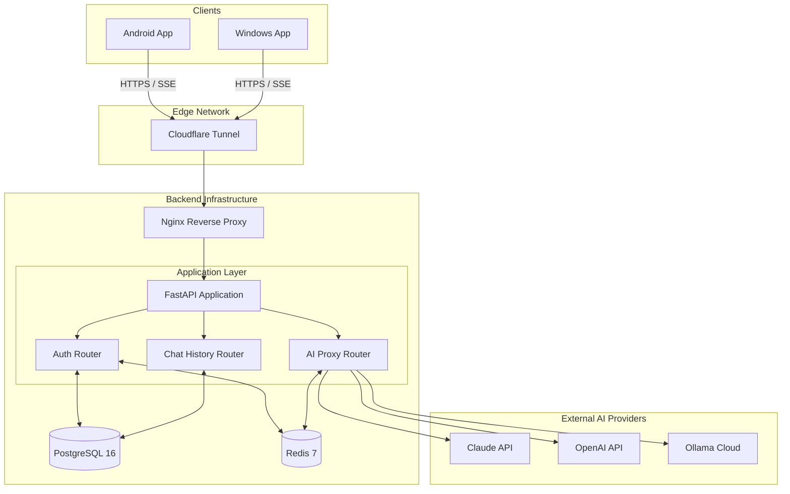
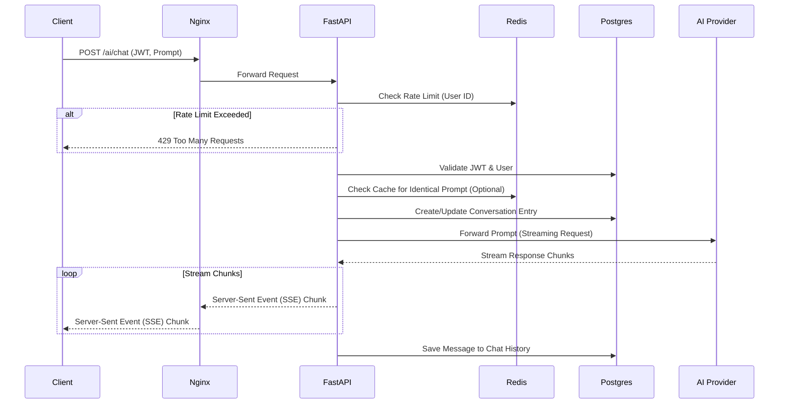
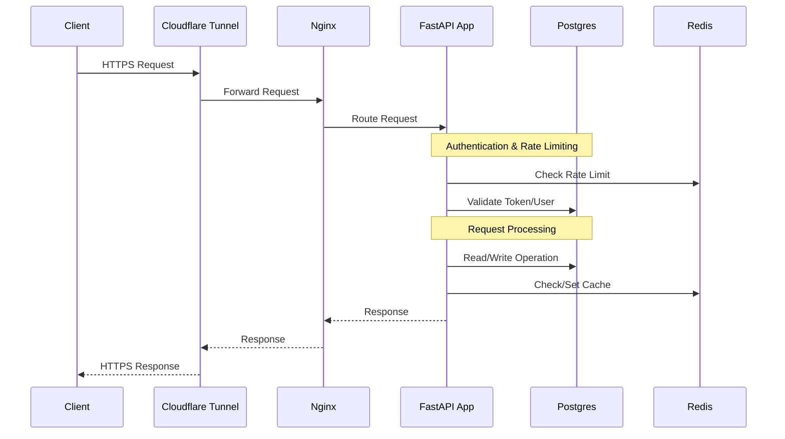

# Open-Brain Backend Service Implementation Plan

This plan details the implementation strategy for the Unified Backend for Android & Windows AI Client Apps, based on the provided PRD. The goal is to build a centralized, secure, and performant backend service that orchestrates AI requests from multiple clients to various AI providers.

## Architecture & Workflow Diagrams

### High-Level Architecture

### AI Chat Request Sequence (Streaming)

> [!IMPORTANT]  
> ## User Review Required
> Please review the architecture and workflow diagrams above to ensure they align with your vision before we begin execution.

## Proposed Changes (By Milestone)

The implementation will be broken down into the following milestones, matching the PRD:

### M1: Foundation
- Initialize FastAPI project structure (using `uvicorn` and `gunicorn`).
- Set up Docker Compose for local development (`fastapi`, `postgres`, `redis`).
- Configure `SQLAlchemy 2.0 (async)` and `Alembic` for database migrations.
- Implement `/health` endpoint.

### M2: Authentication
- Implement `users` and `refresh_tokens` database tables.
- Create `/auth/register`, `/auth/login`, `/auth/refresh`, and `/auth/logout` endpoints.
- Implement JWT generation and validation logic (`access` and `refresh` tokens).
- Integrate Redis for refresh token blacklisting and login rate-limiting.
- Add password hashing (`passlib` with `bcrypt`).

### M3: AI Proxy Layer & Chat History
- Implement `conversations` and `messages` database tables.
- Create `/chats` CRUD endpoints (list, get history, delete).
- Create the core `/ai/chat` endpoint.
- Implement the initial provider adapter (e.g., for Claude) using async `httpx`.
- Implement SSE (Server-Sent Events) streaming for the AI response.

### M4: Advanced AI Features
- Expand provider adapters to include OpenAI and Ollama Cloud.
- Implement Provider selection logic using centrally managed master keys stored securely in the backend environment.
- Add Redis caching for short-TTL AI responses and idempotency keys.
- Implement per-user and per-plan rate limiting for the `/ai/chat` endpoint.

### M5: Infrastructure & Security
- Add Nginx configuration as a reverse proxy.
- Set up and configure Cloudflare Tunnel (`cloudflared`).
- Finalize CORS policies for client access.
- Ensure all endpoints use `Pydantic v2` for strict input validation.

### M6: Documentation & Handoff
- Polish FastAPI auto-generated OpenAPI documentation.
- Export Postman collection.
- Verify Swagger UI (`/docs`) and ReDoc (`/redoc`) accessibility.

### M7: Automated Testing
- Set up `pytest` framework for backend unit and integration tests.
- Write tests for user authentication, JWT rotation, and rate-limiting.
- Write database integration tests for CRUD operations on chat history.
- Write mocked tests for AI provider endpoints to verify streaming behavior without incurring API costs.

## Verification Plan

### Automated Tests
- `pytest` suite for core endpoints.
- DB integration tests for CRUD operations on users and chat history.
- Mocked HTTP requests (`respx` or `pytest-httpx`) to test AI provider integrations without using real credits.
- JWT validation and expiration tests.

### Manual Verification
- Deploy via Docker Compose locally and verify the API through Swagger UI.
- Test user registration and login flows using Postman.
- Verify streaming AI responses using a simple client or `curl`.
- Expose via Cloudflare Tunnel and test remote connectivity.

## General Request Flow Diagram

